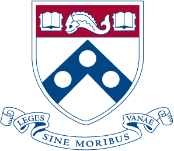

## Education

 M.A. in Statistics and Data Science -- Wharton, Penn '27

 B.S. in Mathematics and Cognitive Science (Double Major) -- UC San Diego '25

## Research Interests

-   Selective Inference
-   Uncertainty Quantification
-   Statistical Learning

## Beyond Academia

- Music production 
- Working out 
- Hiking 
- Philosophy

## Contact

stran3 [at] wharton [dot] upenn [dot] edu

------------------------------------------------------------------------
